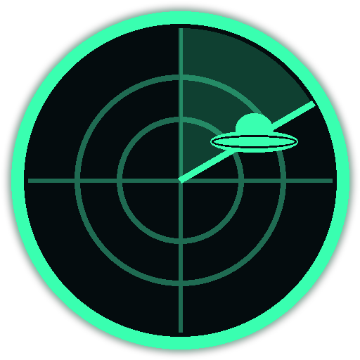

# ZENITH // Anomaly Watch

A desktop monitor for UFO / UAP sightings, unexplained phenomena and declassified government UFO files,
plotted on a live world map. ZENITH runs in its own native window (Qt / PySide6). It draws everything
itself and does not use a browser for its display.



## What it shows

| Layer | Source | Refresh |
|---|---|---|
| ◯ UFO / UAP | [NUFORC](https://nuforc.org): civilian report database, running since 1974 | hourly |
| ◇ UFO Stalker | [ufostalker.com](https://ufostalker.com) (MUFON-linked): live reports with exact position, shape, colour, sound and witness count | every 10 min |
| □ Reddit | r/UFOs, r/UFOB, r/UAP, r/HighStrangeness via the [Arctic Shift](https://arctic-shift.photon-reddit.com) archive | every 10 min |
| ✦ Fireballs | NASA/JPL CNEOS: bolides detected by US government sensors | every 6 h |
| ▣ Declassified: Pentagon | UAP files and videos from the PURSUE release ([war.gov/UFO](https://www.war.gov/UFO/)), from the FBI, the military, NASA and the State Department; files with an incident location are shown on the map | daily |
| ▤ Declassified: UK | British MoD / RAF UFO files from [The National Archives](https://discovery.nationalarchives.gov.uk) (DEFE 24, DEFE 31, AIR 2…) | daily |
| Kp | NOAA SWPC planetary geomagnetic index (storms, aurora) | every 15 min |

The map is drawn from scratch. It shows land outlines (Natural Earth), the day/night terminator with
the subsolar point, and a scanning beam that lights up markers as it passes. New reports pulse on the
map, and a notification appears in the Windows system tray.

* Use the mouse wheel to zoom, drag to pan and double-click to reset the view.
* Click a marker or a list entry to see its details. **FULL REPORT** loads the full NUFORC witness
  account inside the app.
* The **DECLASSIFIED FILES** tab lists more than 600 government documents and has its own search box.
  **SOURCE ↗** opens the original PDF, video or archive catalogue entry.
* **Unexplained only** hides NUFORC reports that have been given an explanation (Starlink, aircraft…).
* **Reddit: sightings only** keeps posts that are flaired as a sighting, carry a photo or video, or
  have a recognised location. Posts removed by moderators are always hidden.
* The search box filters by shape, place or text, e.g. `triangle`, `orb`, `Wiltshire`.

## Running it (Windows)

1. Install Python 3.10 or newer from python.org and tick **Add to PATH**.
2. Make sure Microsoft Edge (built into Windows) or Google Chrome is installed.
3. Double-click **`ZENITH.bat`**. The first run creates `.venv` and installs PySide6, requests and
   websocket-client, which takes about a minute. Later starts are instant.
4. **`ZENITH_DEBUG.bat`** runs the app with a console window, so you can see any errors.
5. **`TEST_SOURCES.bat`** checks that every data source responds from your computer.
6. **`BUILD_EXE.bat`** builds a standalone `dist\ZENITH\ZENITH.exe` with PyInstaller.

Data and settings are stored in `%LOCALAPPDATA%\ZENITH`: events, the geocoding cache, the window
position and the browser profile. If the app ever fails to start, the error is shown in a message box
and also written to `zenith_crash.log` next to the app.

## How NUFORC and Reddit are fetched

**NUFORC** protects its whole domain with a Cloudflare challenge ("Just a moment...") that only real
browsers can pass. About once an hour, ZENITH starts your own Edge or Chrome for a few seconds, using
a separate profile and an off-screen window. The browser passes the check, reads the report table and
closes again. Cookies are kept in `%LOCALAPPDATA%\ZENITH\browser-profile`, so normally no click is
needed. If Cloudflare does ask for one, the browser window moves on screen; tick the box and the
window hides itself again.

**Reddit** blocks clients that are not browsers, so posts are read from the public Arctic Shift
archive instead. Posts appear there about 10–30 minutes after they are published. Arctic Shift checks
each post a second time a few hours later, so posts that moderators remove are also filtered out.

## Geocoding

Town names in reports are geocoded offline using GeoNames, which covers about 70,000 places with more
than 5,000 inhabitants. Smaller places are looked up in OpenStreetMap Nominatim, at most one request
per second, and the results are cached. If no match is found, the marker is placed at the centre of
the state or country and labelled "approximate".

## Project layout

```
main.py                entry point
zenith/app.py          main window, fetch scheduler, notifications
zenith/mapview.py      the map widget (QPainter)
zenith/sources.py      NUFORC, UFO Stalker, Reddit (Arctic Shift), NASA, NOAA, PURSUE, UK National Archives
zenith/realbrowser.py  Edge/Chrome in the background for NUFORC (Cloudflare)
zenith/geocode.py      offline geocoder + Nominatim fallback
zenith/core.py         event model, storage, settings
zenith/data/           world map, town index, icon
```

## Notes

* NUFORC publishes reports in batches after review, so the newest sightings appear days to weeks
  late. UFO Stalker and Reddit are the freshest sources.
* NUFORC times are the local time at the site, without a time zone.
* The PURSUE index is read from war.gov when it can be fetched. Otherwise ZENITH uses a public
  GitHub mirror of release 1.
* Map data: Natural Earth (public domain). Towns: GeoNames (CC BY 4.0).

## Roadmap

* Automatic explanations: check each report against Starlink and ISS passes, rocket launches, air
  traffic (ADS-B) and planet positions.
* More sources: MUFON, GEIPAN (France) and the US National Archives UAP records.
